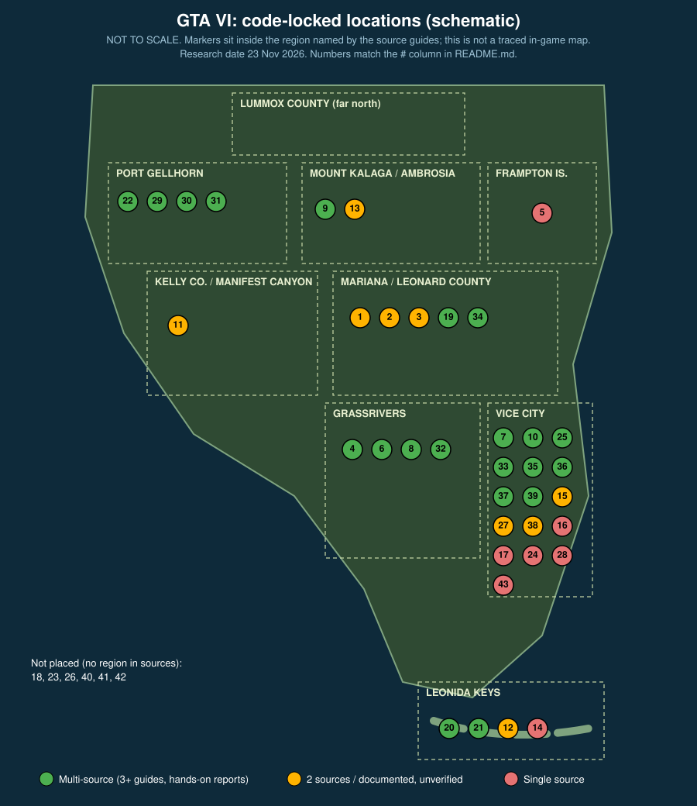

# GTA VI: Hidden Locations & Access Codes (research database)

**Research date:** 23 November 2026, four days after GTA VI launched on PS5 and Xbox Series X|S (19 Nov 2026).
**Method:** Web search plus full reads of 9 guide pages (listed under [Sources](#sources)). Four more (Sportskeeda, MetaForge, Tracker.gg, PC Gamer) blocked automated reading and are **not** counted as corroboration.
**I have not played the game.** Every code below comes from third-party guides. Rockstar has published no codes. All guides are 1–4 days old and several say they have not checked their codes independently.

### How to read the verification column

| Label | Meaning |
|---|---|
| **Confirmed in gameplay** | 3+ independent guides agree, and at least one gives a hands-on account ("seen in game", "we opened this one ourselves", shown on HUD). |
| **Credibly documented** | 2 sources agree, or one source gives a detailed hands-on walkthrough. Not independently corroborated. |
| **Single source** | Only one guide lists it. Treat as unverified. |
| **Not a fixed code** | The code is randomized per player, per save or per robbery. |
| **Confirmed by Rockstar** | *No entry qualifies.* Rockstar has not published any codes. |

**Coordinates:** No source publishes GPS or grid coordinates for these spots. GTABase's interactive map only renders in a browser, so I couldn't read its markers. Rather than invent numbers, each map position below uses the district or landmark the guides name. [`map.svg`](map.svg) places each location by region only. It is a schematic, not a traced in-game map.

---

## 1. Master database

### A. Secrets, puzzles and free-roam hidden areas

| # | Location | Map position | Access code | Entry requirements / how the code is found | Contents / rewards | Verification | Sources |
|---|---|---|---|---|---|---|---|
| 1 | **President's Bunker** (Joe S. Russo bunker) | **Conflict:** "Sharktooth Island, south of Little Hardin Island, Leonard County" (ProdigyGamers) vs "island north of Waning Sands" (GTA Scoop) | **010317** (01‑03‑17) | Chain quest. Talk to the NPC at the IAA "Friends of Freedom" / Joe S. Russo landmark in Downtown (Catalan Blvd bus stop). He gives a Little Cuba address (NW 4th Ave, salmon-colored building with Cuban flags). In that apartment, a photo stand hint gives Russo's birthdate (3 Jan 1917), and a hanging picture points to the island. | Bunker interior: power box, office, phone, recordings. Leads to #2. | Credibly documented (2 sources) | [ProdigyGamers](https://prodigygamers.com/2026/11/21/gta-6-secret-bunker-door-safe-hatch-unlock-codes-mystery-solved/), [GTA Scoop](https://gtascoop.com/guides/gta-6-safe-codes/) |
| 2 | **President's Safe** (inside #1) | Same bunker | **2975** | Power on the electrical box. Sit in the chair, take the cigar and use the phone. A recording in the next room gives "5297" and "Protocol 2". A desk document defines Protocol 2 as 2341. Reorder 5297 by that rule to get 2975 (the guide doesn't fully explain this step). | **President Russo's 1922 Pistol** (unique) and a photo that leads to #3 | Credibly documented (2 sources) | ProdigyGamers, GTA Scoop |
| 3 | **IAA Black Site hatch** | **Conflict:** "Big Pine / Tola Bay, Mariana County" (ProdigyGamers) vs "hatch south of the Ammu-Nation, North Mariana County" (GTA Scoop) | **085355** | The photo from safe #2 carries the word **OBSESS**. Enter it on the keypad (on a tree near the bunker) as 085355. The hatch is hidden in grass behind the bunker door. Inside, power the box and press the red button in the control room to open the exit. | **Legendary Cold War 556 Assault Rifle**. Also an armored vehicle: "armored car" (Prodigy) / "tank" (Scoop). | Credibly documented (2 sources) | ProdigyGamers, GTA Scoop |
| 4 | **Abandoned government facility / "UFO bunker"** | **Conflict:** "restricted area east of Manatee Motel, South Point Airfield" (The Big Lead) vs "east side of Cottonmouth Lake near Shoeless Keys, off Boundary Road" (ScreenHype). Probably the same site. | **A permutation of 1‑2‑3‑4** (no repeats). Varies per player: one writer got 2341, another 3214. | Trigger it by witnessing the UFO abduction at night. The Big Lead puts that on the NW road in Manifest Canyon. ScreenHype says after Chapter 1, near the Starlet Motel in Kelly County after 2 am. Then sleep as that character until the dream. In the dream, the keypad answer comes from "counting the lines above it". At the real site, break the fence, take the roof hatch down to the keypad, and use the elevator. Light all four panel lights. Take the milk from the left door and put it in the machine behind the right door. **Avoid the middle door (radiation).** | **Permanent max health, stamina and focus boost.** You carry out a live alien to be beamed up. Achievement: *The Truth Is Out There*. | Confirmed in gameplay (3 sources, 2 hands-on) | [The Big Lead](https://www.thebiglead.com/gta-6-keypad-door-code-south-point-airfield/), [ScreenHype](https://www.screenhype.co.uk/how-to-access-the-abandoned-site-in-gta-6-the-truth-is-out-there/), [Game Rant](https://gamerant.com/gta-6-safe-codes-keypad-combinations-door-passwords-list/) |
| 5 | **Frampton Island bunker** | "Northeast of Lummox County, top of the map" | **3612** | No in-game clue is known. Game Rant says the community **brute-forced** it. An X user had earlier reported the door with no code found. | Stairs, a sewer pipe, a hanging body, eerie music. **"Nothing else down here"**, so far just set dressing. | Single source for the code (the door itself has 2 reports) | [Game Rant](https://gamerant.com/gta-6-frampton-island-bunker-code/), [X post](https://x.com/BearPigCentral/status/2124629054628495538) |
| 6 | **Pelican Valley Crab Research Outpost** (3-step chain) | Pelican Valley swamp. Region disputed: Grassrivers / Gullet Marsh / "Mariana County swamps, north of the Keys". | **CLEAVES** (PC login) → **0072** (safe) → **0212** (dock door) | Flip the breaker outside. CLEAVES is chalked on the floor of a side room. The researcher's note gives specimen ID 0036; double it to get 0072. The note in that safe gives 0212 for the keypad door at the end of the dock. Some early guides wrongly gave 0072 for the dock door. | Safe: ~$1,000+ and the dock code. Dock building: **Crabshack VF5 SMG** and marked bills. | Confirmed in gameplay (6+ sources) | [Vice City DB](https://vicecitydb.org/codes), [RetroBroker](https://retrobroker.com/en-US/us/blog/gta-6-safe-codes-locations), GTA Scoop, Game Rant, [GTA6Heists](https://www.gta6heists.com/robberies/safe-codes), [IBTimes](https://www.ibtimes.co.uk/gta-6-safe-codes-gang-hideouts-hidden-locations-1833861) |
| 7 | **Haunted Marbelle Hotel** (Silent Hill-style secret) | Crosstown, Vice City | **955214** | GTA Scoop: an "Old Note" on the roof. The search summary said the code is written on a top-floor wall. Game Rant puts the safe on the ground floor. | **Crowex Ambassador 'Breakfast' watch** (collectible) and cash | Confirmed in gameplay (3 sources) | Game Rant, GTA Scoop, IBTimes |
| 8 | **Cottonmouth Lake abandoned trailer** | SW sandy spit of Cottonmouth Lake, by the burned houses, south of Gullet Marsh. Some map apps label it "Key Lento #19". | **44017** | White marks on the postcards and photos on the bedroom wall. Safe is under the microwave. Can be done during *Find the Lost Drugs*. | Cash and a **Los Santos Pounders card** | Confirmed in gameplay (5 sources; GTA Scoop: "we opened this one ourselves") | GTA Scoop, Vice City DB, Game Rant, RetroBroker, IBTimes |
| 9 | **Mount Kalaga firewatch shed** | Base of the watchtower, Mount Kalaga National Park (Stone Hills) | **69185** (some guides say 691865) | A purple sticky note / board in the cabin at the top of the tower. | **Area 69 Watch Guard Logbook** | Confirmed in gameplay. **Conflict:** Vice City DB, Game Rant and GTA Scoop say 69185; RetroBroker says 691865. 69185 is the majority reading, so try it first. | Vice City DB, Game Rant, GTA Scoop, RetroBroker, GTA6Heists |
| 10 | **Boobie's laptop → Del Rio Blvd garage** | Laptop: Bayside apartment, Vice City. Garage: Del Rio Blvd next to Auntie's Place, La Perle. | **MuffinsQueen15** (laptop) → **92665** (garage) | Chapter 3. Password clues: dog photo (Muffins), painting (Queen), "Class of '15". Early guides printed "MuffinsKing15", which is wrong. The garage code is in the laptop's "Unknown" messages, and the keypad only works after you read them. | **Vanessa's Growler** (pink Pfister) and a free garage | Confirmed in gameplay (3 sources) | Vice City DB, GTA Scoop, Game Rant |
| 11 | **Father Scrumpy's Red Apple Orchard garage** | Manifest Canyon (Vice City DB) / Kelly County (Game Rant) | **360782** | The code is in a magazine inside the barn. | **Declasse Applesauce Bobcat** | Credibly documented (2 sources) | Vice City DB, Game Rant |
| 12 | **Key Lento party house garage** | Key Lento, Leonida Keys | **092319** | Clue not documented | **Invetero Spiderweb Coquette** | Credibly documented (2 sources; Vice City DB marks it "Unconfirmed") | Game Rant, Vice City DB |
| 13 | **Abandoned laundry / laundromat** | Belville, Ambrosia | **62412** | Get in through the roof opening. The code is written beneath the collectible card. | Reinforced wall safe; loot not specified | Credibly documented (3 sources, but Vice City DB says "not yet verified") | Game Rant, RetroBroker, Vice City DB |
| 14 | **Belpoint shipwreck** | Leonida Keys | **4242** | Not documented | Cash | Single source | Game Rant |
| 15 | **Black Eagle (B.E.) Warehouse** | Balsero, Vice City | **789987** (office door) → **031462** (safe) | Keypad on the office door in the front corner of the warehouse | **Black Eagle Import Kalinga .50** pistol and cash | Credibly documented (2 sources; GTA6Heists: "not read on screen", though the game shows the safe code starts with 03) | Game Rant, GTA6Heists |
| 16 | **Slum House** | Vice City | **9790** | Not documented | Loot | Single source | Game Rant |
| 17 | **"Stormy" back room** | Vice City | **7869** | Not documented | Not listed | Single source | Game Rant |
| 18 | **Tiger mansion** (guarded house with a caged tiger) | Not stated | **4377** | House robbery. Sticky note at the reception desk. | $550 cash | Single source ("seen in game") | GTA6Heists |
| 19 | **'74 Vamos garage** | Grayson, Leonard County | **2727** | *Steal Vehicles for Moses* (Ch. 2). Read the house-number plaques on the next house. | **Declasse '74 Vamos** | Confirmed in gameplay (5 sources) | GTA Scoop, Game Rant, RetroBroker, GTA6Heists |

### B. Story and mission codes

These are fixed codes the game hands you, usually by phone, text or job card, and many are saved in your phone's Notes.

| # | Location | Map position | Code | Requirements / clue | Contents / rewards | Verification | Sources |
|---|---|---|---|---|---|---|---|
| 20 | Moonstone Boutique back room (acid lab) | Artist Village, Key Lento | **0420** | Ch. 1 *Lab Fees*. Threaten the clerk, or read the sticky note. | Hidden acid lab | Confirmed in gameplay (7 sources) | all major guides |
| 21 | Brian's Lockup | Key Lento, beside Isla Tropical Private Club | **7700** | *Lab Fees*. Brian phones it in. Play as Jason; the metal door is down the side alley. | Brian's strongbox for fencing loot | Confirmed in gameplay (7 sources) | all major guides |
| 22 | Delights Cabaret, Frankie's office | Port Gellhorn | **2008** | Ch. 2 *Afternoon Delight* / "Rob Vicki's Boss". Vicki texts it. | TitanVault safe: ~$115 and marked bills | Confirmed in gameplay | Vice City DB, GTA Scoop, Game Rant, IBTimes, GTA6Heists |
| 23 | Raul's garage shutter | Not stated | **2404** | Ch. 3 *First Impressions*. Saved to Notes. | **Schafter V12** getaway car | Credibly documented (2 sources) | GTA Scoop, Game Rant |
| 24 | Balsero Kitty Litter Lab (central building) | Balsero, Vice City | **1999** | Ch. 3 *Take Out Kitty Litter* | $2,500 | Single source | Game Rant |
| 25 | Yasmani's Jewelry Jobs: Casa de Empeño / Richardson Jewelry / Donovan Banks & Co. | Vice City (Richardson: Downtown; Donovan: Peacock Bay) | **1680 / 6815 / 0104** | Ch. 3. Codes are on the job card. **They only work during the job;** robbing later gives a random code. | Buffalo Skull Chain / Diamond Ring / Amethyst Necklace | Confirmed in gameplay | Vice City DB, GTA Scoop, Game Rant, IBTimes, GTA6Heists, RetroBroker |
| 26 | Pilot Pete's hangar (back room, red door) | Sundown Private Airfield | **3718** | Ch. 4 *The Last Mile: Passing the Torch* | Pete's stash / cash | Confirmed (4 sources, though GTA6Heists rates it "one guide") | Game Rant, GTA Scoop, IBTimes, GTA6Heists |
| 27 | Legendary Custom Jewelry | Ocean Beach mall, Vice City | **4207** | Ch. 4 mall heist (*Mall Rats*). Staff give it up. | Jewelry | Credibly documented; **"may vary"** | GTA Scoop, GTA6Heists |
| 28 | Fleeca on Thompson, manager's safe | Vice City | **8140** | Ch. 3 *Credit Check* | Marked bills | Single source ("seen in streams") | GTA6Heists |

### C. Gang hideout safes (Illegal Operations)

Clear the hideout, then open the safe. **Caveat:** Vice City DB, RetroBroker and GTA6Heists all warn these codes *may* be randomized per save. If one fails, look for the on-site note (most hideouts have one) or use explosives.

| # | Hideout (gang) | Map position | Code | Clue on site | Rewards | Verification |
|---|---|---|---|---|---|---|
| 29 | Brooks Boatworks (Kolt & Associates) | NE Port Gellhorn docks; go in through the east fence hole | **6823** | Wall map upstairs in the grey building east of the main warehouse. It lists all three Kolt codes. | Gang cash, possible unique weapon or car | Confirmed in gameplay (shown on HUD) |
| 30 | La Cascara Motel (Kolt) | Port Gellhorn | **6969** | Brooks wall map | Gang cash, **Scrapper VF5C SMG** (RetroBroker) | Confirmed |
| 31 | Kingpin Bowling (Kolt) | Port Gellhorn, NE office by the pins | **0300** | Brooks wall map / notepad | Gang cash | Confirmed (enter the leading zero) |
| 32 | Sunrise RV Park dock warehouse (Kingfishers) | Disputed: Cottonmouth Lake / Grassrivers / Hamlet | **6769** | Note in the shack east of the roundabout | Gang cash | Confirmed |
| 33 | Nova Auto Junkyard (M7) | Hamlet | **7777** | Written on the wall behind the safe | Gang cash | Confirmed |
| 34 | Farm Fix meth lab (Final Chapter) | McKittrick Farm, Leonard County (RetroBroker says "Belville hideout") | **2121** | Notepad in the office | ~$3,000 | Confirmed |
| 35 | Janjak's Garage (San4San) | La Perle, Vice City | **4444** | Sticky note on the fridge | Cash, pink **Declasse Gin Tulip**, **San4San KZ‑59** rifle | Confirmed by 5 guides. RetroBroker alone says "no static code yet". |
| 36 | Illegal Sneaker Trade / Drip Drops (San4San) | Vice City | **4124** | The notepad in the first safe's back room points to the building across the street, where the second safe uses 4124. | Gang cash | Confirmed |
| 37 | Casa Guardia (Guardia Bros.) | Little Cuba, Vice City | **1965** | In the hideout | ~$9,600 | Confirmed |
| 38 | Saber Shipping Facility (Guardia Bros.) | Balsero | **1122** *or* **1965** | Code written inside | Gang cash | **Conflict.** Game Rant, IBTimes and GTA Scoop say 1122; RetroBroker says 1965. GTA6Heists found it already open twice. Try 1122 first. |
| 39 | Saber Shipping Yard (Guardia Bros.) | Vice City port / Little Cuba | **8046** | Map in an office | ~$9,800 | Confirmed |
| 40 | Palmer Fishing Warehouse (La Polilla Negra) | Watson Bay | **1886** | Note on the ground-floor computer | ~$3,000 | Credibly documented (2) |
| 41 | Watson Bay Safehouse (La Polilla Negra) | Watson Bay | **1819** | Message on a computer | ~$3,300 | Credibly documented. RetroBroker says "no static code". |
| 42 | Thirsty Wolf Biker Clubhouse | Not stated | **1982** | Not documented | Not listed | Single source (Game Rant) |
| 43 | Leonida Carrier Warehouse | Balsero | **9256** | Not documented | Gang cash | Single source (GTA6Heists, "not read on screen") |

### D. Excluded on purpose: randomized codes

Safes in **ordinary shops, pawn shops, payday lenders, banks and jewelry stores** generate a new code each robbery or save. Game Rant, GTA Scoop, Sortiraparis and GTA6Heists all agree on this. Lists of "codes" for Lombank, Fleeca, ShoreFront, Kowalski, White Sand Pawn or Avery Pawn (6499) report what one player saw and **won't work in your game**. To get the code, threaten an employee ("Safe code?"), read the staff email or sticky note on site, use the Snap Gun, or use a sticky bomb.

---

## 2. Best hidden locations (ranked)

1. **#4 Abandoned facility / UFO bunker.** It gives the only permanent stat boost found so far (max health, stamina and focus), has a multi-stage dream puzzle, unlocks an achievement, and the code differs per player.
2. **#1 → #2 → #3 President's Bunker chain.** A three-location conspiracy trail (Russo landmark → Little Cuba apartment → island bunker → IAA black site) ending in two unique weapons: the **1922 Pistol** and the **Legendary Cold War 556**, plus an armored vehicle.
3. **#6 Pelican Valley Crab Outpost.** A tidy three-step environmental puzzle (chalked password → doubled specimen ID → note in the safe) ending in the **Crabshack VF5 SMG**.
4. **#7 Haunted Marbelle Hotel.** An atmospheric horror-homage location with a collectible Crowex watch.
5. **#10 Boobie's laptop → Del Rio garage.** A deduction password puzzle that unlocks a unique car *and* a free garage.
6. **#11 Father Scrumpy's orchard / #12 party house garage.** Hidden unique vehicles (Applesauce Bobcat, Spiderweb Coquette).
7. **#15 Black Eagle Warehouse.** Two keypads in a row, ending in the Kalinga .50.
8. **#9 Firewatch shed.** A lore item (Area 69 logbook) that hints at a wider alien thread.
9. **#8 Cottonmouth trailer.** An easy early-game pickup with a collectible card.
10. **#5 Frampton Island.** Not worth it for loot ("set dressing"), but the creepiest find, and possibly unfinished (see Unknowns).

## 3. Code & access quick reference

Codes from multi-source entries are in **bold**. Codes marked † are single-source or disputed.

| Code | Unlocks |
|---|---|
| **0420** | Moonstone Boutique acid lab door (Key Lento) |
| **7700** | Brian's Lockup (Key Lento) |
| **2008** | Delights Cabaret office safe (Port Gellhorn) |
| 2404 | Raul's garage shutter |
| 1999 † | Balsero Kitty Litter Lab garage |
| **1680 / 6815 / 0104** | Yasmani jobs: Casa de Empeño / Richardson / Donovan Banks (job only) |
| **3718** | Pilot Pete's hangar, Sundown Airfield |
| 4207 † | Legendary Custom Jewelry (may vary) |
| 8140 † | Fleeca Thompson manager's safe |
| **2727** | '74 Vamos garage, Grayson |
| **CLEAVES** | Pelican Valley outpost PC |
| **0072** | Pelican Valley outpost safe |
| **0212** | Pelican Valley dock building |
| **44017** | Cottonmouth Lake trailer safe |
| **955214** | Marbelle Hotel safe |
| **69185** (alt. 691865 †) | Mount Kalaga firewatch shed |
| **MuffinsQueen15** | Boobie's laptop (Bayside) |
| **92665** | Del Rio Blvd garage (La Perle) |
| 360782 | Father Scrumpy's orchard garage |
| 092319 | Key Lento party house garage |
| 62412 | Belville abandoned laundry safe |
| 4242 † | Belpoint shipwreck safe |
| 789987 / 031462 | B.E. Warehouse office door / safe (Balsero) |
| 9790 † | Slum House safe |
| 7869 † | "Stormy" back-room safe |
| 4377 † | Tiger mansion office safe |
| 010317 | President's Bunker door |
| 2975 | President's Safe |
| 085355 (OBSESS) | IAA Black Site hatch |
| 1‑2‑3‑4 permutation (per player) | Abandoned facility / UFO bunker door |
| 3612 † | Frampton Island bunker (brute-forced) |
| **6823 / 6969 / 0300** | Kolt hideouts: Brooks Boatworks / La Cascara / Kingpin Bowling |
| **6769** | Sunrise RV Park (Kingfishers) |
| **7777** | Nova Auto Junkyard (M7) |
| **2121** | Farm Fix meth lab (Final Chapter) |
| **4444** | Janjak's Garage (San4San) |
| **4124** | Illegal Sneaker Trade (San4San) |
| **1965** | Casa Guardia |
| 1122 † (or 1965) | Saber Shipping Facility |
| **8046** | Saber Shipping Yard |
| 1886 / 1819 | Palmer Fishing Warehouse / Watson Bay Safehouse |
| 1982 † | Thirsty Wolf clubhouse |
| 9256 † | Leonida Carrier Warehouse |

## 4. Exploration checklist

**Secrets and puzzles**
- [ ] #1 Russo landmark (Downtown) → Little Cuba apartment → President's Bunker door `010317`
- [ ] #2 President's Safe `2975`: 1922 Pistol
- [ ] #3 IAA Black Site hatch `085355`: Cold War 556 and armored vehicle
- [ ] #4 UFO abduction at night → dream → abandoned facility keypad (1-2-3-4 permutation): permanent stat boost
- [ ] #5 Frampton Island bunker `3612`
- [ ] #6 Pelican Valley outpost `CLEAVES` → `0072` → `0212`: Crabshack VF5
- [ ] #7 Marbelle Hotel `955214`: Crowex watch
- [ ] #8 Cottonmouth Lake trailer `44017`: Pounders card
- [ ] #9 Mount Kalaga firewatch shed `69185`: Area 69 logbook
- [ ] #10 Boobie's laptop `MuffinsQueen15` → Del Rio garage `92665`: Vanessa's Growler
- [ ] #11 Father Scrumpy's orchard `360782`: Applesauce Bobcat
- [ ] #12 Key Lento party house `092319`: Spiderweb Coquette
- [ ] #13 Belville laundry `62412`
- [ ] #14 Belpoint shipwreck `4242`
- [ ] #15 B.E. Warehouse `789987` → `031462`: Kalinga .50
- [ ] #16 Slum House `9790`
- [ ] #17 Stormy `7869`
- [ ] #18 Tiger mansion `4377`
- [ ] #19 '74 Vamos garage `2727`

**Story and missions:** [ ] #20 `0420` [ ] #21 `7700` [ ] #22 `2008` [ ] #23 `2404` [ ] #24 `1999` [ ] #25 `1680/6815/0104` [ ] #26 `3718` [ ] #27 `4207` [ ] #28 `8140`

**Gang hideouts:** [ ] #29 `6823` [ ] #30 `6969` [ ] #31 `0300` [ ] #32 `6769` [ ] #33 `7777` [ ] #34 `2121` [ ] #35 `4444` [ ] #36 `4124` [ ] #37 `1965` [ ] #38 `1122/1965` [ ] #39 `8046` [ ] #40 `1886` [ ] #41 `1819` [ ] #42 `1982` [ ] #43 `9256`

## 5. Unknowns & community leads

- **Frampton Island bunker (#5).** The code was brute-forced, and nobody has found an in-game clue for 3612. A hanging body and nothing else suggests either a later update or an unfound trigger, much like GTA V's Mount Chiliad. **High-value lead.**
- **Is Frampton linked to the President's Bunker?** Game Rant compares the two but doesn't say they're connected. Sources also disagree on where the President's Bunker is ("Sharktooth Island, Leonard County" vs "north of Waning Sands").
- **Port Gellhorn docks container.** An unmoderated GTABase comment says a container at "row 25, tier 1" holds a Vapid car, with the clue on a dock office PC. No code is given.
- **Marabunta camp near Millport.** A GTABase comment mentions a container with a "???" item on a table that gives endurance, single-use per character. No code is involved; unverified.
- **No static code yet** (per RetroBroker): Hog Stars Garage, Manatee Motel, Watson Bay Safehouse, Janjak's Garage. Others have since published codes for the last two.
- **Per-save randomization of hideout codes.** Unresolved. Several guides say these codes "may vary". Hands-on reports of identical codes (HUD screenshots) suggest they're mostly fixed.
- **UFO keypad mechanics.** The 1-2-3-4 randomization and the "count the lines" dream clue come from two writers. Nobody has documented exactly how the dream clue maps to your real code.
- **Mile Zero Air Station (military base).** PC Gamer has a guide, but I couldn't read it. Whether a keycard or code is involved is unknown.
- **Cheat codes.** Guides say the button inputs haven't all been found.
- **Unreadable sources** to check by hand: [Sportskeeda](https://www.sportskeeda.com/esports/all-safe-locker-codes-gta-6), [MetaForge](https://metaforge.app/gta-6/gta-6-safe-codes), [Tracker.gg](https://tracker.gg/gta6/safe-codes), [GTABase interactive map (87 safes)](https://www.gtabase.com/gta-6/map/?feature=safe).

## Sources

All pages were read on 23 Nov 2026.

- ProdigyGamers, *Secret Bunker Door, Safe, Hatch Unlock Codes* (21 Nov 2026): https://prodigygamers.com/2026/11/21/gta-6-secret-bunker-door-safe-hatch-unlock-codes-mystery-solved/
- The Big Lead, *Keypad door in South Point Airfield* (19 Nov 2026): https://www.thebiglead.com/gta-6-keypad-door-code-south-point-airfield/
- ScreenHype, *How to access the Abandoned Site* (21 Nov 2026): https://www.screenhype.co.uk/how-to-access-the-abandoned-site-in-gta-6-the-truth-is-out-there/
- Game Rant, *Every Safe Code, Keypad Combination & Laptop Password* (22 Nov 2026): https://gamerant.com/gta-6-safe-codes-keypad-combinations-door-passwords-list/
- Game Rant, *Frampton Island Bunker Code* (23 Nov 2026): https://gamerant.com/gta-6-frampton-island-bunker-code/
- GTA Scoop, *Every Safe, Door and Keypad Code* (updated 22 Nov 2026): https://gtascoop.com/guides/gta-6-safe-codes/
- Vice City DB, *Codes* (updated 22 Nov 2026): https://vicecitydb.org/codes
- IBTimes UK, *GTA 6 Safe Codes Full List* (22 Nov 2026): https://www.ibtimes.co.uk/gta-6-safe-codes-gang-hideouts-hidden-locations-1833861
- RetroBroker, *All GTA 6 Safe Codes* (20 Nov 2026): https://retrobroker.com/en-US/us/blog/gta-6-safe-codes-locations
- GTA6Heists, *All 41 Codes* (checked 23 Nov 2026): https://www.gta6heists.com/robberies/safe-codes
- Sortiraparis, *All the Safe and Door Codes* (updated 22 Nov 2026): https://www.sortiraparis.com/en/what-to-do-in-paris/gaming/articles/358955-gta-6-all-safe-and-door-codes
- BearPig on X, Frampton Island door report: https://x.com/BearPigCentral/status/2124629054628495538
- Release date: [Fox10 / AP](https://www.fox10tv.com/2026/10/16/gta-6-locks-nov-19-release-date-after-delays/?outputType=amp)
